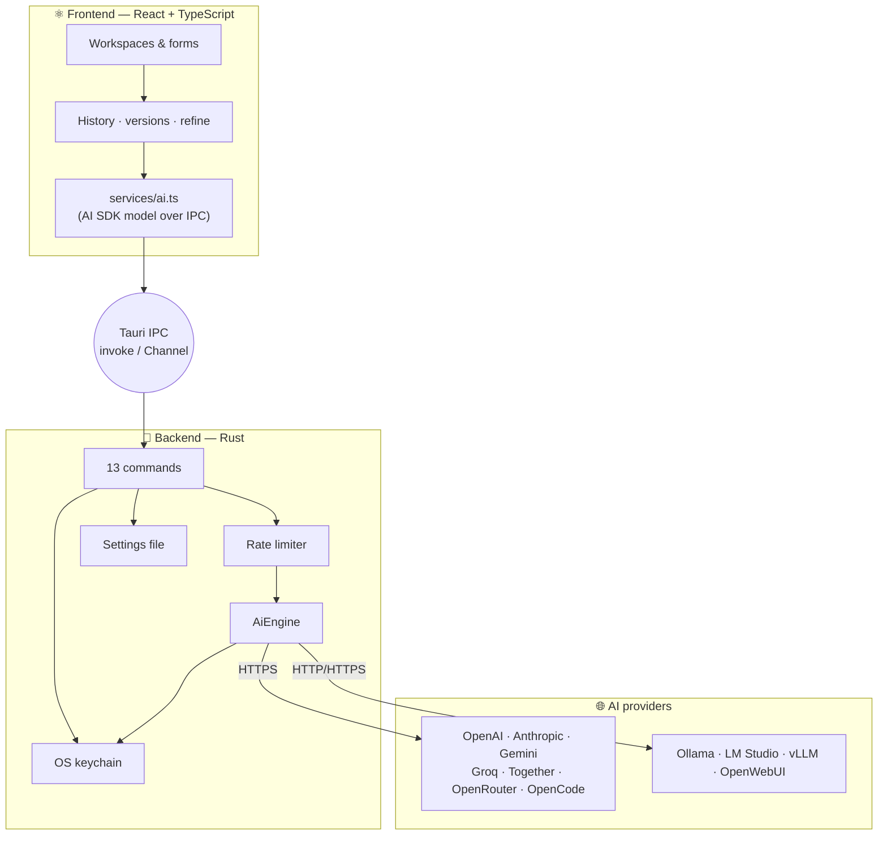
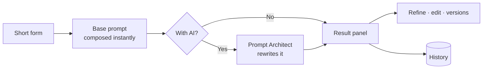

# 🛠️ Development Guide

Everything you need to understand, run, test and release **Nexus Prompt Suite**
(currently **v1.3.0**).

**Contents**

1. [Overview](#-overview)
2. [Architecture](#-architecture)
3. [Project layout](#-project-layout)
4. [Local setup](#-local-setup)
5. [How a prompt is made](#-how-a-prompt-is-made)
6. [Backend commands](#-backend-commands)
7. [Where data lives](#-where-data-lives)
8. [Extending Nexus](#-extending-nexus)
9. [Testing](#-testing)
10. [Releasing](#-releasing)
11. [Troubleshooting](#-troubleshooting)

---

## 🧭 Overview

Nexus is a [Tauri 2](https://tauri.app) desktop app with two halves:

| Half | Stack | Responsibility |
| :--- | :--- | :--- |
| **Frontend** | React 18, TypeScript (strict), Vite, Tailwind CSS | Workspaces, forms, history, prompt display, settings |
| **Backend** | Rust (`reqwest`, `tokio`, `keyring`) | Talking to AI providers, keychain access, rate limiting, local settings |

They talk through Tauri's IPC (`invoke`). **All network calls to AI providers are
made by Rust**, never by the web view. That is what lets the backend keep API keys
away from the interface entirely.

### Principles

| Principle | In practice |
| :--- | :--- |
| 🔐 **Keys never reach the UI** | The UI can write or delete a key; only Rust ever reads it. |
| 🕵️ **Zero telemetry** | No analytics, no remote logging, no servers of our own. |
| 🧱 **Small and typed** | TypeScript `strict`, Rust traits for providers, data-driven templates. |
| 🧩 **Short forms** | A form with many empty fields makes a worse prompt, so every field must earn its place. |
| 🛡️ **Fail safe** | If an AI call fails, the user still gets the base prompt. |

---

## 🧱 Architecture



A request travels like this: the UI calls `invoke("call_ai", …)` **without a key** →
Rust validates the parameters, takes a rate-limit slot, reads the key from the
keychain, calls the provider and returns text (or streams tokens through a Tauri `Channel`).

---

## 📂 Project layout

```
nexus-prompt-suite/
├── VERSION                         Current version (keep in sync, see "Releasing")
├── docs/                           Screenshots and documentation standards
├── .github/                        Issue and pull request templates
└── prompt-suite/                   The app (run every npm command from here)
    ├── package.json
    ├── vite.config.ts              Vite + Vitest config; injects the app version
    ├── index.html                  App shell with the content security policy
    ├── src/renderer/src/
    │   ├── App.tsx · main.tsx
    │   ├── components/             Layout, Sidebar, SettingsDashboard, ui/
    │   ├── contexts/AppContext.tsx Settings, providers and model list
    │   ├── features/suite/         The workspaces (see below)
    │   ├── hooks/                  useAIInference, useHistory, useSessionState…
    │   ├── lib/                    i18n, history, secureStorage, utils, validators
    │   └── services/               ai.ts and the AI SDK model bridge
    └── src-tauri/
        ├── tauri.conf.json         Window, bundle and CSP
        ├── capabilities/           Tauri permissions
        └── src/
            ├── lib.rs              IPC commands and validation
            ├── rate_limiter.rs
            ├── tests.rs
            └── ai/                 providers.rs · engine.rs · types.rs · engines/
```

### Inside `features/suite/`

| File | Purpose |
| :--- | :--- |
| `PromptSuite.tsx` | The shared workspace shell: toolbar, AI/No-AI switch, view modes, history, versions |
| `Suite{Genesis,Dev,Audit,Studio,Social}.tsx` | One file per workspace. Each builds its prompt from a short form |
| `SuiteTemplates.tsx` | The template library, custom templates and variable form |
| `SuiteOutputPanel.tsx` | Result panel: versions, refine bar, edit, copy, download |
| `HistoryPanel.tsx` | Saved prompts: search, favorites, reopen, export/import |
| `formSchemas.ts` | Field definitions for each workspace form |
| `data.ts` · `templatesNew.ts` | The built-in templates (ES/EN) |
| `varMeta.ts` | Field type, options, suggestions and examples for template variables |
| `fieldUtils.ts` | Turns option ids into readable labels for prompts |

---

## 🚦 Local setup

### Prerequisites

| Tool | Version |
| :--- | :--- |
| Node.js | 20 or newer |
| Rust | stable, 1.77.2 or newer ([rustup](https://rustup.rs)) |
| **Windows** | WebView2 (usually preinstalled) and the MSVC C++ build tools |
| **macOS** | Xcode command line tools (`xcode-select --install`) |
| **Linux** | `libgtk-3-dev libwebkit2gtk-4.1-dev libappindicator3-dev librsvg2-dev patchelf` |

### Run it

```bash
cd prompt-suite
npm install
npm run tauri dev
```

This starts Vite on `localhost:5173` and opens the native window. The first Rust
build takes a few minutes; later ones are incremental.

### Scripts

Run these from `prompt-suite/`:

| Command | What it does |
| :--- | :--- |
| `npm run tauri dev` | Run the full app with hot reload |
| `npm run dev` | Frontend only, in a browser (no Rust, so AI calls won't work) |
| `npm test` | Frontend tests (Vitest) |
| `npx tsc --noEmit` | Type check |
| `npm run build` | Type check and production frontend build |
| `npm run tauri build` | Installer for your current platform, in `src-tauri/target/release/bundle/` |

Rust commands run from `prompt-suite/src-tauri/`: `cargo test`, `cargo clippy`, `cargo fmt`.

---

## 🧪 How a prompt is made



1. Each workspace turns form values into a **base prompt** (no AI involved). Option
   ids are converted to readable labels with `optionLabel()`.
2. If **With AI** is on, the base prompt goes through the *Prompt Architect*
   system prompt in `PromptSuite.tsx`. It is told to use the user's concrete values
   and never to invent `{{placeholders}}`.
3. The result becomes version **v1**. Refinements and manual edits add new versions.
4. If the AI call fails, the base prompt is still shown and copyable.
5. Every generation is stored in the history together with a snapshot of the form,
   so **Reopen** restores it.
6. `findOrphanVars()` scans the base prompt and the AI output for leftover
   `{{TOKENS}}` and warns before the user copies an unfinished prompt.

Form state survives switching views and workspaces thanks to `useSessionState`,
an in-memory store that is cleared when the app closes.

---

## 🔌 Backend commands

All commands live in `src-tauri/src/lib.rs` and are registered in `run()`.

| Command | Group | Purpose |
| :--- | :--- | :--- |
| `get_settings` · `save_settings` | Settings | Read/write the preferences file (1 MB cap, secrets stripped) |
| `call_ai` | Inference | One-shot completion |
| `call_ai_stream` | Inference | Streaming completion returned as one string |
| `stream_ai` | Inference | Streams tokens to the UI through a Tauri `Channel` |
| `list_provider_models` · `list_ollama_models` | Models | Ask a provider for its real model list (10 s timeout) |
| `get_available_providers` | Providers | Provider metadata for the UI |
| `save_provider_api_key` | Keychain | Store or delete a provider key (write-only) |
| `has_provider_api_key` | Keychain | Is a key stored? Returns a boolean, never the key |
| `secure_storage_set` · `_get` · `_remove` | Keychain | Store the local-storage encryption key (allow-listed names only) |

### Limits enforced in Rust

| Limit | Value |
| :--- | :--- |
| Requests | 30 per 60 s, 3 at a time (RAII guard) |
| Messages per request | 200, each at most 128 KB |
| Streamed response | 256 KB |
| Settings file | 1 MB |
| API key | 1024 characters, no whitespace or control characters |
| Temperature · context | 0–2 · up to 1,048,576 |

### Endpoint rules

- Remote endpoints must be **HTTPS** and must not contain credentials.
- Local endpoints (`localhost`, `127.0.0.1`, `::1`) may use HTTP on an allow-listed
  port (80, 443, 1234, 3000, 4000, 5000, 5173, 8000, 8080, 11434, 31415).
- Hosted providers (OpenAI, Anthropic, Groq, Together, OpenRouter, OpenCode…) only
  accept their **official host**. Self-hosted providers (Ollama, LM Studio, vLLM,
  OpenWebUI) accept any valid endpoint. See `resolve_base_url()` in `providers.rs`.
- Redirects are disabled on every provider call.

---

## 💾 Where data lives

| Data | Location | Protection |
| :--- | :--- | :--- |
| API keys | OS keychain, service `prompt-suite-ia:<provider>_key` | Native keychain |
| Local-storage encryption key | OS keychain, service `prompt-suite-secure-storage` | Native keychain |
| Preferences | `.nexus_preferences.json` in the app config folder | No secrets; keys are stripped before writing |
| History · custom templates · remembered values | Web view local storage | AES-GCM, key from the keychain |
| Form drafts | Memory | Gone when the app closes |

---

## 🧩 Extending Nexus

### Add a template

1. Add an object to `templatesNew.ts` (ES **and** EN text). Use `{{VARIABLES}}` and
   finish with `IDIOMA: {{LANG_OUTPUT}}` / `LANGUAGE: {{LANG_OUTPUT}}`.
2. Follow the structure *Role → Goal → Context → Steps → Output format → Language*.
3. If a variable should be a dropdown, a large text box or have suggestions,
   describe it in `varMeta.ts`.
4. Run `npm test`. The template tests check unique ids, known categories and that
   ES and EN use the same variables.

### Add a provider

1. Add an entry to `all_providers()` in `src-tauri/src/ai/providers.rs`.
2. Add the variant to `Provider` in `types.rs`.
3. If it speaks the OpenAI chat format it works out of the box
   (`openai_compat.rs`). Otherwise add an engine under `ai/engines/`.
4. Hosted provider? Make sure its default URL is the real official host, because that
   is what the key is pinned to.
5. Add tests in `tests.rs`.

### Add a form field

Keep it rare. Before adding one, ask: *would most users fill this in?* If not, leave
it out. There is a test that fails if a form grows beyond 8 fields.

---

## ✅ Testing

| Suite | Command | Covers |
| :--- | :--- | :--- |
| **Frontend** | `npm test` | Hooks, history, secure storage, templates, forms, utilities |
| **Backend** | `cargo test` (in `src-tauri/`) | Engine behavior, endpoint rules, key validation, stream parsing |
| **Keychain** | `cargo test -- --ignored test_keyring_smoke` | A real round trip against your OS keychain (run it by hand) |
| **Types** | `npx tsc --noEmit` | TypeScript strict mode |
| **Lint** | `cargo clippy` | Rust lints |

Before opening a pull request:

```bash
# from prompt-suite/
npm test && npx tsc --noEmit

# from prompt-suite/src-tauri/
cargo test && cargo clippy && cargo fmt --check
```

Dependency checks: `npm audit` and `cargo audit` (install with `cargo install cargo-audit`).

---

## 🚢 Releasing

Installers are **not** built from this repository. This repo holds only the source:
there is no release workflow here. Official builds are produced by a separate
**private builder repository**, which checks out this code, builds it for macOS (Apple
Silicon and Intel), Linux and Windows, and keeps the result as a **draft release** until
the maintainers publish it.

For contributors this means:

- Nothing in this repo publishes binaries, and pull requests don't trigger builds.
- You can always build your own installer locally with `npm run tauri build`.
- There is no automated CI on pull requests yet, so please run the
  [checks listed above](#-testing) before opening one.

### Version checklist

Bump the version in all of these (the sidebar reads it from `package.json`
automatically):

| File | Field |
| :--- | :--- |
| `VERSION` | whole file |
| `prompt-suite/package.json` | `version` |
| `prompt-suite/package-lock.json` | the first two `version` fields (run `npm install`) |
| `prompt-suite/src-tauri/Cargo.toml` | `version` |
| `prompt-suite/src-tauri/Cargo.lock` | the `prompt-suite` entry (updated by `cargo build`) |
| `prompt-suite/src-tauri/tauri.conf.json` | `version` |

Then push, and optionally tag the commit so the builder can build exactly that
version:

```bash
git push origin main
git tag v1.3.0
git push origin v1.3.0
```

---

## 🩺 Troubleshooting

| Symptom | Fix |
| :--- | :--- |
| `EBUSY` / dev server crashes while Rust compiles (Windows) | Fixed by ignoring `src-tauri/` in Vite's watcher (`vite.config.ts`). If it returns, close stray `cargo` or app processes and retry. |
| Port 5173 already in use | Stop the other Vite process; the port is fixed (`strictPort`). |
| "Could not access the system credential manager" | Unlock your keychain. On Linux install and start a Secret Service provider such as GNOME Keyring or KeePassXC. |
| A provider answers *Check your API key and model configuration* | Release builds hide provider error bodies on purpose. Run a debug build to see the details. |
| Saved history or templates won't load after a keychain reset | The encryption key was lost, so old data can't be decrypted. It is replaced with a fresh key on next save. |

Still stuck? See [SUPPORT.md](SUPPORT.md).
