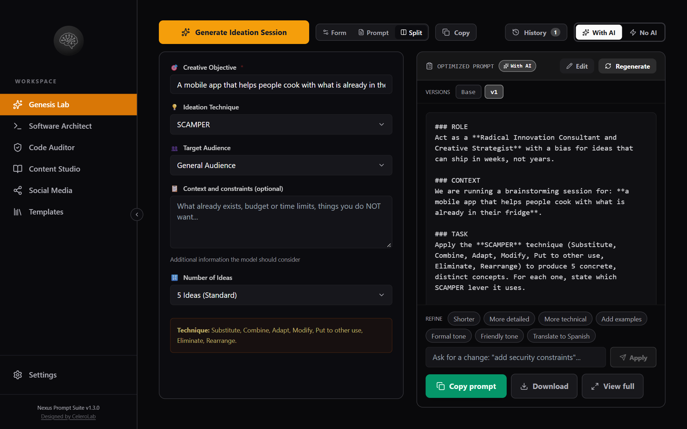
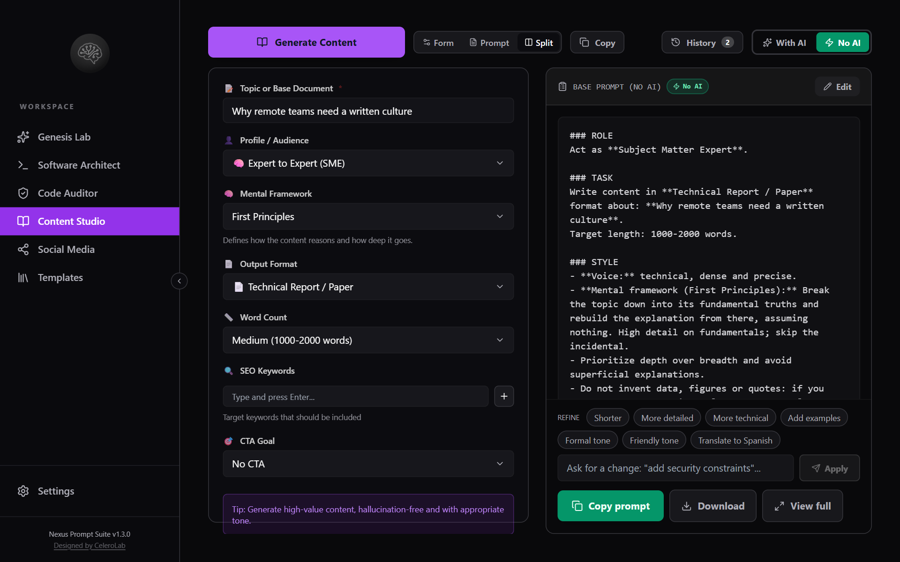
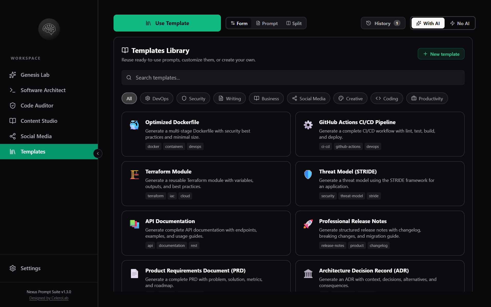
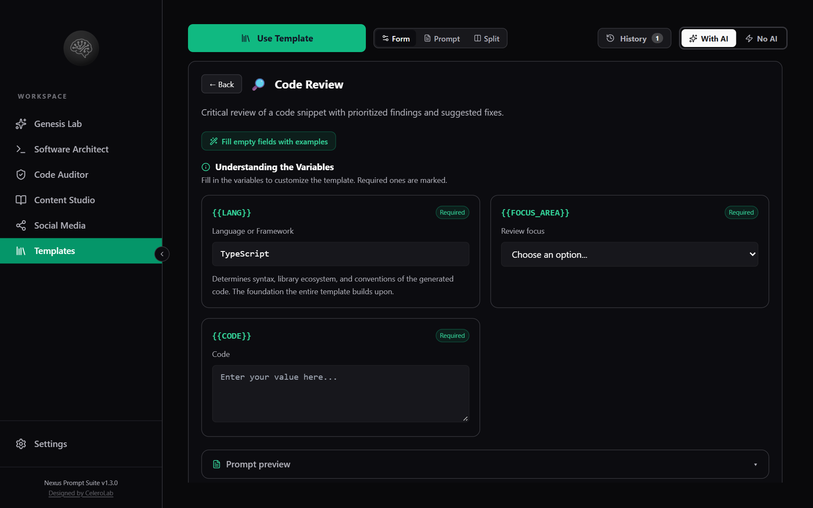
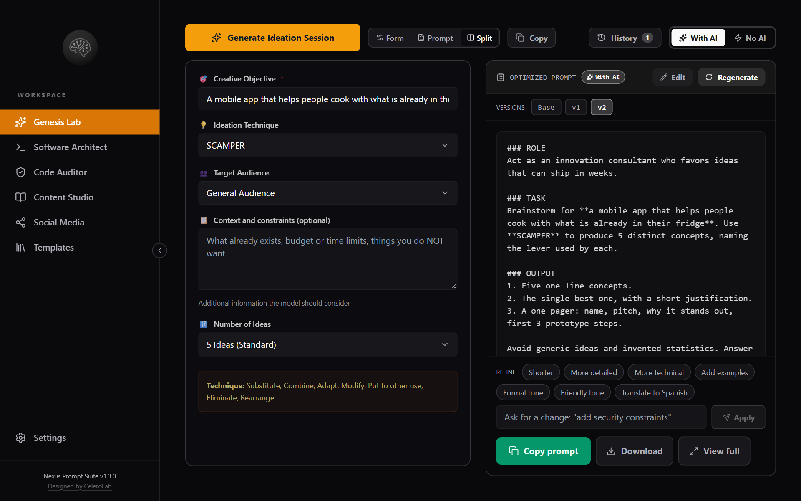
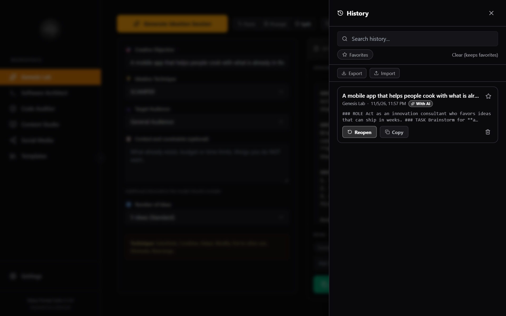
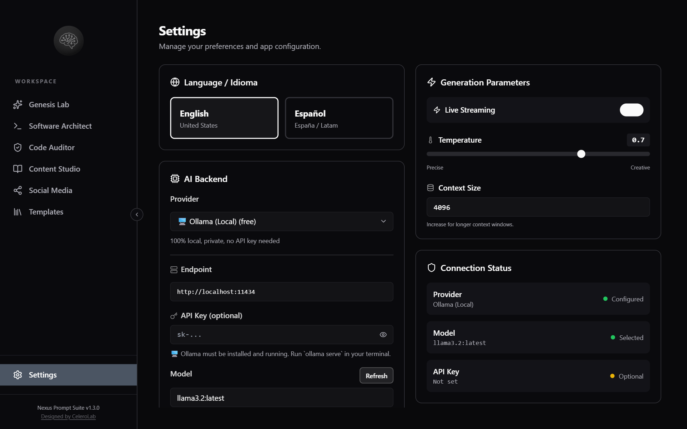

<div align="center">


# Nexus Prompt Suite

**Stop wrestling with AI. Start getting answers worth keeping.**

A desktop workshop that turns a blank prompt box into well-structured,
reusable prompts for any large language model.

[](VERSION)
[](LICENSE)
[](https://tauri.app)
[](https://www.rust-lang.org)
[](https://react.dev)


[**Download**](https://nexus.celerolab.com) ·
[Documentation](DEVELOPMENT.md) ·
[Report a bug](https://github.com/ekosistema/nexus-prompt-suite/issues/new?template=bug_report.md) ·
[Request a feature](https://github.com/ekosistema/nexus-prompt-suite/issues/new?template=feature_request.md)



</div>

---

## ✨ Why you'll like it

Most people talk to AI the way they talk to a search engine: half a sentence, a
hope, and a shrug. Nexus gives the model what it actually needs — clear intent,
relevant context and the right constraints — without you having to remember how.

| | What you get |
| :--- | :--- |
| 🎯 **Better answers, fewer retries** | Structured prompts built the right way, in a few clear fields. |
| ♻️ **Nothing gets lost** | Every prompt lands in a history you can reopen, refine, favorite and export. |
| 🔒 **Private by design** | No account, no telemetry, no servers. API keys live in your OS keychain. |
| 🔌 **Any model** | Local with Ollama or hosted with OpenAI, Anthropic, Gemini and more. |

---

## 🚀 How it works

1. **Pick a workspace** that matches your goal.
2. **Answer a few questions.** Every field has a sensible default, and the forms
   are deliberately short.
3. **Get your prompt.** It appears instantly. Optionally let an AI model polish it.
4. **Refine and reuse.** Tweak it, compare versions, and find it again in your history.

---

## 🧰 Six workspaces, each built for a real job

| Workspace | Use it to… |
| :--- | :--- |
| 🧬 **Genesis Lab** | Brainstorm with seven proven techniques: SCAMPER, Six Thinking Hats, Blue Ocean, First Principles and more. |
| 💻 **Software Architect** | Turn a feature idea into a dense technical brief. Nine project types, with an optional security checklist. |
| 🛡️ **Code Auditor** | Request a focused security and quality review of a repo or pasted code, optionally aligned with SOC 2, ISO 27001, PCI DSS, HIPAA or GDPR. |
| 🎨 **Content Studio** | Shape ideas into articles, whitepapers, scripts and more, using a **mental framework** (First Principles, Feynman, Critical Thinking, 80/20, Analogy or Systems Thinking) to control depth and detail. |
| 📱 **Social Strategist** | Craft platform-native posts with the right hook, engagement goal and persuasion framework. |
| 📋 **Template Library** | Start from **43 bilingual (ES/EN) templates** across DevOps, Security, Writing, Business, Social, Creative, Coding and Productivity. |

<div align="center">

<br /><sub>Content Studio in <b>No AI</b> mode: the <b>mental framework</b> shapes how the content reasons and how deep it goes</sub>
</div>

<br />

<table>
<tr>
<td width="50%"><br /><sub><b>Template Library:</b> 43 templates, searchable by category</sub></td>
<td width="50%"><br /><sub><b>Typed variables:</b> dropdowns, suggestions and one-click examples</sub></td>
</tr>
</table>

Prefer to write your own? Save any prompt as a **custom template**; `{{VARIABLES}}`
are detected automatically.

---

## ⚡ With AI or No AI: you choose

A switch in the toolbar controls how prompts are produced:

| Mode | What happens | Best for |
| :--- | :--- | :--- |
| ✨ **With AI** | Your structured prompt is rewritten by your chosen model into a sharper one. | Getting the most polished result. |
| ⚡ **No AI** | The prompt is composed instantly from your answers. No model involved. | Speed, privacy, or when you're offline. |

If the AI is unreachable you still get your prompt: the base version is always
shown and ready to copy.

<div align="center">

<br /><sub>Refine with one click and keep every version (Base, v1, v2…)</sub>
</div>

---

## ♻️ Reuse everything

- **History** — every generation is saved automatically (up to 100 entries,
  favorites are never trimmed). Reopen one and the form comes back exactly as you left it.
- **Refine** — one-click tweaks (*shorter, more detailed, more technical, add
  examples, formal tone, friendly tone, translate*) or type your own instruction.
- **Versions** — each refinement becomes a new version (v1, v2…). Switch back any time.
- **Edit by hand** — adjust the result before copying it.
- **Remembered values** — things like your tech stack or audience are filled in for
  you on other templates. Long content such as code is never remembered, and one
  click forgets everything.
- **Export / import** your history as JSON.

<div align="center">

<br /><sub>History: search, favorite, reopen, copy, export and import</sub>
</div>

### No more orphan variables

Every dropdown starts with a sensible default, and when the AI rewrites your
draft it is told to use your concrete values and never to invent `{{placeholders}}`.
If something is genuinely missing it is flagged as `[MISSING: …]`, and an
on-screen warning highlights any unfinished variable before you copy.

---

## 🔌 Works with the models you already use

| Provider | Notes |
| :--- | :--- |
| **Ollama** | 100% local and free. Optional API key if you protect your instance. |
| **OpenAI · OpenRouter · Groq · Together AI** | Hosted models. Nexus fetches the real, current model list. |
| **Anthropic Claude · Google Gemini** | Fully supported, with live model discovery. |
| **LM Studio · OpenWebUI · vLLM** | Point Nexus at your own self-hosted endpoint. |
| **OpenCode Zen · OpenCode Go** | For those who live in OpenCode. |

<div align="center">

<br /><sub>Settings: pick a provider, model and generation parameters</sub>
</div>

Your settings (provider, model, temperature, context size) are remembered
between sessions.

---

## 🔐 Privacy and security

- **Keys stay in your keychain.** API keys are stored in Windows Credential
  Manager, macOS Keychain or the Linux Secret Service. The interface can write or
  delete a key but can never read it back; only the Rust backend uses it, and only
  when a request is made.
- **Keys only go where they belong.** Hosted providers are only ever contacted at
  their official address, so a tampered setting can't redirect your key elsewhere.
- **Local data is encrypted.** History and custom templates are encrypted with a key
  held in the keychain.
- **No telemetry.** Prompts go only to the provider you pick, or nowhere at all with Ollama.
- **Hardened by default.** Strict content security policy, HTTPS required for remote
  endpoints, request size limits and rate limiting.

Details and how to report a vulnerability are in [SECURITY.md](SECURITY.md).

---

## 📥 Get started

### Install

1. **Download** the installer for your platform from
   [nexus.celerolab.com](https://nexus.celerolab.com).
2. **Launch** it. On macOS, the first launch may ask for your confirmation.
3. **Choose a provider** in *Settings*:
   - 🔒 Want privacy? Pick **Ollama** and run models on your own hardware.
   - ☁️ Prefer the cloud? Paste your API key and pick a model.
4. **Pick a workspace and generate.** That's it.

> 💡 The app window needs at least **1280 × 720** pixels.

### Run from source

```bash
git clone https://github.com/ekosistema/nexus-prompt-suite.git
cd nexus-prompt-suite/prompt-suite
npm install
npm run tauri dev
```

You'll need Node.js 20+ and Rust. See [DEVELOPMENT.md](DEVELOPMENT.md) for the
full setup, architecture and testing guide.

---

## ❓ Quick answers

<details>
<summary><b>Is it free?</b></summary>

Yes, Nexus is free and open source under the MIT license. Hosted providers charge
for their own API usage; Ollama and other local options cost nothing.
</details>

<details>
<summary><b>Does Nexus send my data anywhere?</b></summary>

Only to the AI provider you choose, and only when you generate a prompt with AI.
With **No AI** mode or a local provider such as Ollama, nothing leaves your computer.
</details>

<details>
<summary><b>Where is my data stored?</b></summary>

On your machine only. Preferences are a small JSON file in the app config folder
(never containing keys). History and custom templates live in encrypted local storage.
</details>

More in [SUPPORT.md](SUPPORT.md).

---

## 📚 Documentation

| Document | What's inside |
| :--- | :--- |
| [DEVELOPMENT.md](DEVELOPMENT.md) | Architecture, project layout, setup, testing and releasing |
| [CONTRIBUTING.md](CONTRIBUTING.md) | How to report bugs, propose features and open pull requests |
| [SECURITY.md](SECURITY.md) | Security model and responsible disclosure |
| [SUPPORT.md](SUPPORT.md) | Where to get help, plus FAQ |
| [docs/INLINE_STANDARDS.md](docs/INLINE_STANDARDS.md) | How we document code |
| [CODE_OF_CONDUCT.md](CODE_OF_CONDUCT.md) | How we treat each other |

---

## 🤝 Contributing

Nexus is open source and welcomes help: a typo fix, a better template, a new
provider or a whole new workspace. Start with [CONTRIBUTING.md](CONTRIBUTING.md).

## 📄 License and credits

Released under the **MIT License**. See [LICENSE](LICENSE).

Nexus stands on the shoulders of a remarkable open-source ecosystem: Tauri, Rust,
React and many more. Thanks to those communities, and to the teams behind OpenAI,
Anthropic, Google Gemini, Ollama, OpenRouter, Groq, Together AI and OpenCode for the APIs that make
this possible.

<div align="center">

Built with care by [**CeleroLab**](https://celerolab.com) ·
[info@celerolab.com](mailto:info@celerolab.com)

<sub>Copyright © 2026 CeleroLab</sub>

</div>
